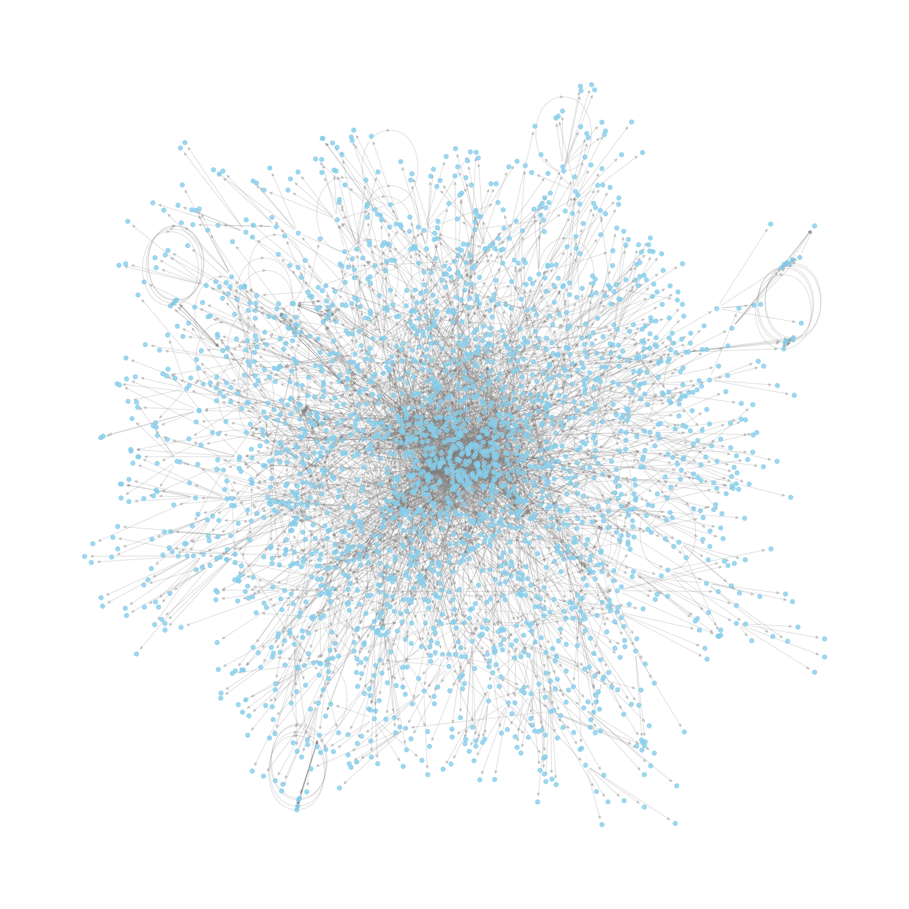
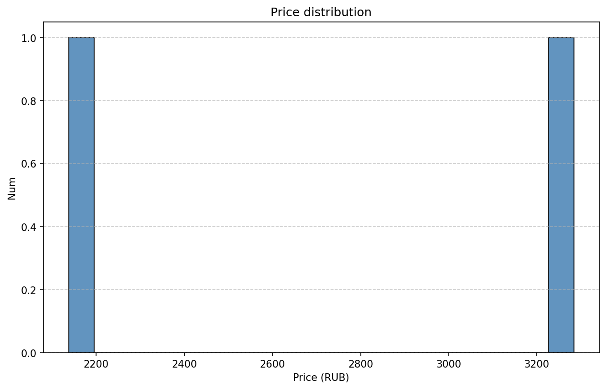

# Web, API, FastAPI
*Дз2*

## Содержимое папки hw2
- [`wikipedia_articles.py`](wikipedia_articles.py)
  
  Принимает ссылку на статью в Википедии и глубину поиска. Возвращает json, для каждого элемента(статьи) в котором - список статей, на которые в этой статье есть ссылка

  `--url` - ссылка на статью
  `--out_json` -имя выходного файла
  `--depth` - глубина поиска, по умолчанию 3
  `--max_links` - максимальное число обойденных ссылок

- [`draw_wiki.py`](draw_wiki.py)
  

Рисует ориентированный граф из json, полученного с помощью предыдущего скрипта. 

Командой `./wikipedia_articles.py --url https://en.wikipedia.org/wiki/Guar --depth 5 --max-links 5` был получен файл Guar.json и отрисован командой `./draw_wiki.py --json Guar.json`:

----

- [`amazon_selenium_crawl.py`](amazon_selenium_crawl.py)
  
Обходит 5 страниц амазона для запроса и собирает товары и цены на них. Возвращает json для результата.

`--query` - запрос

- [draw_amazon.py](draw_amazon.py)

`--json` - входной файл

Рисует гистограмму для результата.

Командами `./amazon_selenium_crawl.py --query` и `./draw_amazon.py --json labubu.json` была получена гистограмма:

